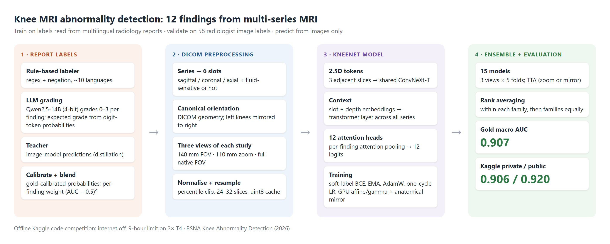
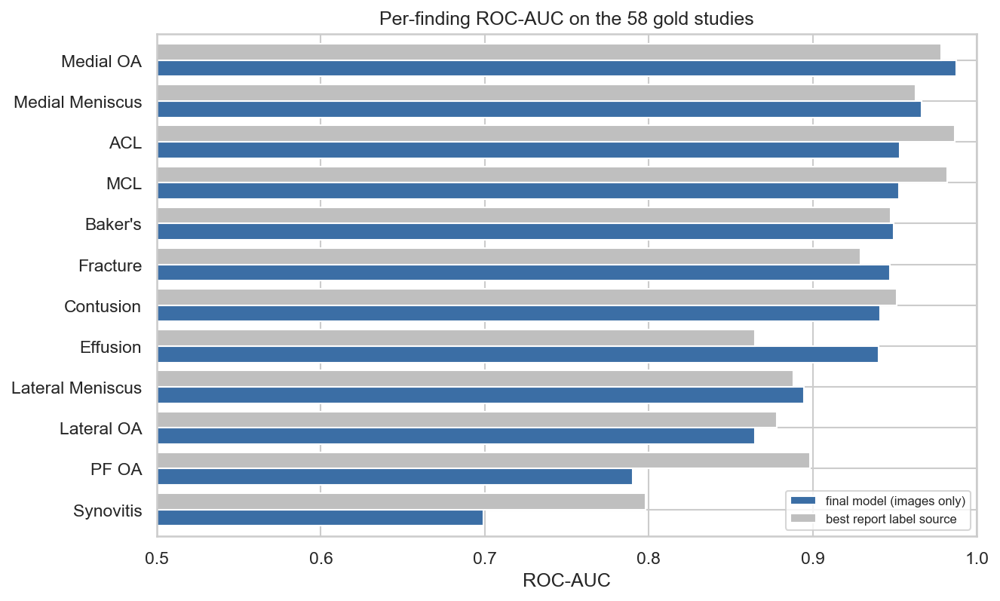
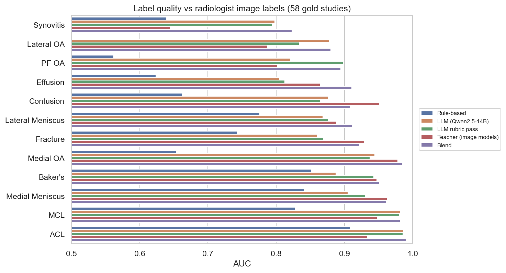
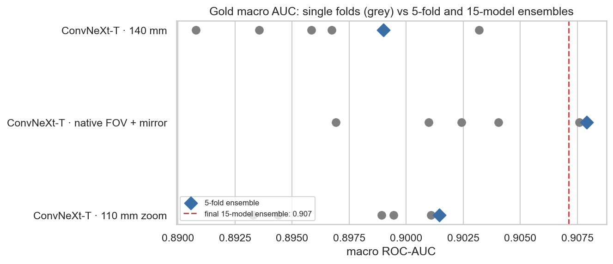

# Knee MRI Abnormality Detection

**Multi-label detection of 12 knee abnormalities from multi-series MRI, trained on labels extracted from multilingual radiology reports with an LLM.**




## Results

**Test macro ROC-AUC: 0.907** (15-model ConvNeXt-T ensemble, images only).

All scores in this README are on the **test set**: the 58 studies whose 12 findings were labelled by radiologists from the images. No model is trained on them.

*Data: RSNA Knee Abnormality Detection, a Kaggle research code competition (offline inference, 9-hour limit).*

<p align="center"> </p>

## The problem

The task is to predict 12 findings for every knee MRI study: ACL, MCL, medial and lateral meniscus tears, medial, lateral and patellofemoral OA, effusion, synovitis, Baker's cyst, bone contusion and fracture. The scoring metric is macro ROC-AUC.

The hard part is the labels, not the images:

- The dataset is about **820K DICOM files (570 GB)**. Of the **4,407 training studies**, only **58** have labels read from the images by radiologists.
- The other 4,349 have only a **free-text radiology report**, written in about ten languages (English, Spanish, Turkish, Croatian, Greek, German, Bulgarian, Dutch, French and others).
- The **test set has no reports**: predictions must come from the images alone.

## Approach

**1. Report labels** ([notebook 02](notebooks/02_report_labelling.ipynb), [`kneemri/labels`](src/kneemri/labels))
- A multilingual **rule-based labeler** (regex with negation handling) is the fallback source.
- **LLM grading:** Qwen2.5-14B-Instruct (4-bit, on 2× T4) grades every report 0–3 per finding as JSON. It reads the probabilities of the grade-digit tokens to get a continuous *expected grade*. This breaks ties and improves ranking quality.
- **Teacher labels:** predictions of earlier image models (distillation).
- Grades are **calibrated** to probabilities on the 58 radiologist-labelled studies, with a Beta prior and a monotone constraint. Sources are then **blended per finding** with weight (AUC on those studies − 0.5)².

  Label quality on the test set (macro AUC): rule-based **0.71** → LLM **0.88** → blend **0.93**. See [Experiments](#experiments) for the LLM comparison.

**2. DICOM preprocessing** ([`kneemri/preprocessing.py`](src/kneemri/preprocessing.py), [`kneemri/cache.py`](src/kneemri/cache.py))
- Each study's series are assigned to 6 slots: sagittal, coronal and axial, each fluid-sensitive or not.
- Each series is reoriented to a canonical view using DICOM geometry, and left knees are mirrored to right.
- The image is cropped to a physical field of view, clipped to intensity percentiles, resampled to a fixed slice count, and cached as uint8.
- Three views of every study feed the ensemble: a **140 mm** field of view, a **110 mm zoom**, and the **full native** field of view.

**3. Model: KneeNet** ([`kneemri/model.py`](src/kneemri/model.py))
- Every 2.5D window (3 adjacent slices) of every series becomes one token through a shared ImageNet ConvNeXt-T.
- Slot and depth embeddings are added, then one **transformer layer** gives context across slices and series.
- **12 attention-pooling heads**, one per finding, produce the 12 logits. Missing series are masked out of the attention.
- **Training:** BCE on soft labels, EMA weights, AdamW with a lower backbone learning rate, one-cycle schedule.
  - Augmentation runs on the GPU: affine and gamma transforms, plus an *anatomical* left/right mirror that keeps medial as medial. Plain flips are never used, because they would swap medial and lateral.
  - Each training step reads only 16 random windows per study; inference reads all of them.

**4. Ensemble and inference** ([`kneemri/inference.py`](src/kneemri/inference.py))
- There are 3 views × 5 folds = **15 models**.
- Test-time augmentation averages identity with zoom, or with mirror for the mirror-trained family.
- Predictions are rank-averaged within each family, then the families are averaged with equal weight.
- The submission is validated before it is written, and the whole pipeline runs offline within Kaggle's time limit.

<p align="center"></p>

## Experiments

All numbers are macro ROC-AUC on the 58-study test set. With only 58 studies, differences below about 0.01 are within noise, so the LLM comparison reports bootstrap 95% confidence intervals.

### Report labelling: which LLM?

Every model gets the same prompt, the same 0–3 rubric, the same decoding and the same 4-bit weights; only the model changes ([notebook 06](notebooks/06_llm_benchmark_kaggle.ipynb), [`labels/benchmark.py`](src/kneemri/labels/benchmark.py)). Each report is graded on its own, and the grades are scored directly against the radiologists' image labels.

| Labeller | Macro AUC | 95% CI | Difference vs Qwen2.5-14B (95% CI) |
|---|---|---|---|
| Claude (same rubric, reference) | 0.894 | 0.863–0.921 | +0.010 (−0.010 to +0.030) |
| **Qwen2.5-14B-Instruct (used)** | **0.884** | 0.851–0.915 | — |
| Gemma-2-9B-it | 0.879 | 0.843–0.909 | −0.006 (−0.023 to +0.012) |
| Llama-3.1-8B-Instruct | 0.864 | 0.829–0.894 | −0.020 (−0.045 to +0.003) |
| Mistral-7B-Instruct-v0.3 | 0.833 | 0.797–0.867 | −0.052 (−0.078 to −0.024) |
| Rule-based keywords | 0.736 | 0.703–0.768 | −0.149 (−0.178 to −0.121) |

- Every LLM beats the keyword rules by 0.10–0.16, so the gain comes from LLM grading itself, not from one particular model.
- Qwen2.5-14B is the best open model tested. Gemma-2-9B and Llama-3.1-8B are statistically tied with it; Mistral-7B is clearly worse (its CI is entirely below zero).
- A second prompt version (0–4 scale with image-aligned definitions and few-shot examples) scored **0.873** vs **0.884** for the 0–3 prompt, so the simpler prompt was kept.
- The models differ most on the subtle findings: lateral OA ranges from 0.55 (Mistral) to 0.88 (Qwen), PF OA from 0.71 (Llama) to 0.84 (Gemma).

Per-finding AUCs: [`reports/llm_benchmark_gold.csv`](reports/llm_benchmark_gold.csv).

**Label sources and blend** ([`reports/metrics/label_quality_vs_gold.csv`](reports/metrics/label_quality_vs_gold.csv)):

| Label source | Macro AUC |
|---|---|
| Rule-based (hard labels) | 0.713 |
| LLM, Qwen2.5-14B | 0.884 |
| LLM, Claude (same rubric) | 0.894 |
| Teacher (earlier image models) | 0.887 |
| **Per-finding blend of all sources** | **0.927** |

The blend weights and calibration are fitted on these 58 studies, so 0.927 is an in-sample figure; the image-model scores below are not affected by this.

### Image model: which backbone?

| Backbone / setup | Models | Test AUC per fold | Test AUC, 5-fold ensemble |
|---|---|---|---|
| ConvNeXt-T, 140 mm field of view | 5 | 0.891–0.903 | 0.899 |
| ConvNeXt-T, 110 mm zoom | 5 | 0.893–0.901 | 0.901 |
| ConvNeXt-T, native field of view + mirror | 5 | 0.897–0.908 | 0.908 |
| **ConvNeXt-T, all 3 setups (final)** | **15** | — | **0.907** |
| EfficientNetV2-S, 140 mm field of view | 5 | 0.898–0.910 | — |
| DINOv2 ViT-S (2.5D) | 1 | 0.63–0.68 after 3 epochs; loss stopped improving, abandoned | — |

- **EfficientNetV2-S matches ConvNeXt-T** within noise (0.898–0.910 vs 0.891–0.903 per fold at 140 mm). Adding it to the ensemble gave no gain: both backbones learn from the same labels, so their errors are correlated. ConvNeXt-T was kept as the single backbone; a larger ConvNeXt-S showed no gain over Tiny in early runs.
- **The self-supervised ViT (DINOv2) did not converge** on 2.5D MRI windows within the GPU budget.
- **Diversity came from views, not backbones:** three fields of view of the same ConvNeXt-T give 0.899–0.908 individually and 0.907 combined.

**Training and inference choices that were tested:**

| Experiment | Result | Decision |
|---|---|---|
| Self-training (out-of-fold predictions as an extra label source) | 0.893 vs 0.898 | Dropped |
| More epochs (up to 20) | Folds converge by about epoch 7 | Kept 10 |
| Sampling windows at inference (32/48 windows × 4 draws) | Slightly worse than all windows | Use all windows |
| Gamma test-time augmentation | No change | Not used |
| Zoom test-time augmentation on EfficientNetV2-S | −0.002 to −0.003 | Not used for that backbone |

## Key findings

- **Labels were the bottleneck, not the model.** The image models cannot beat their training labels by much. Every large score gain came from better report labels; a different backbone (EfficientNetV2-S), a bigger one (ConvNeXt-S) or more epochs did not help.
- **LLM grading works across models.** Four open LLMs score 0.83–0.88 against 0.74 for keyword rules; the choice of Qwen2.5-14B is supported, not arbitrary.
- **Images can still go beyond the reports.** The model beats the best report-derived label source on effusion, fracture, medial OA and lateral meniscus.
  - It trails on synovitis and PF OA. Radiologists reading the images flag these findings far more often than reports mention them.

## Repository structure

```
knee-mri-abnormality-detection/
├── configs/                 # YAML: shared training settings + one file per model family
├── src/kneemri/
│   ├── preprocessing.py     # DICOM -> canonical, cropped, normalised volumes
│   ├── cache.py             # builds the uint8 training cache (ZIP shards)
│   ├── labels/              # keyword labeler, LLM grader, calibration + blending, LLM benchmark
│   ├── data.py              # dataset, folds, GPU augmentation, anatomical mirror
│   ├── model.py             # KneeNet
│   ├── train.py             # one fold of one family
│   ├── inference.py         # offline TTA + rank ensemble + validated submission
│   └── metrics.py
├── notebooks/
│   ├── 01_data_understanding.ipynb
│   ├── 02_report_labelling.ipynb
│   ├── 03_preprocess_and_train_kaggle.ipynb
│   ├── 04_inference_kaggle.ipynb
│   ├── 05_results.ipynb
│   └── 06_llm_benchmark_kaggle.ipynb
├── reports/                 # figures + metric tables
├── docs/pipeline.png
└── tests/                   # unit tests (labeler, model, augmentation, ensemble, calibration)
```

## Quick start

```bash
git clone https://github.com/lucky07-07/knee-mri-abnormality-detection.git
cd knee-mri-abnormality-detection
pip install -r requirements.txt && pip install -e .
pytest -q
```

**Data:** the data is from the [RSNA Knee Abnormality Detection](https://www.kaggle.com/competitions/rsna-knee-abnormality-detection) competition, and its rules do not allow redistribution. Download it with the Kaggle API and see [data/README.md](data/README.md).

**Reproduce:**
1. Notebooks 01 and 02 run locally on `train.csv`.
2. Notebooks 03 and 04 run on Kaggle with GPU (2× T4) and hold the DICOM-heavy steps: cache, LLM labels, training, inference.
3. Notebook 05 rebuilds every result above from the saved predictions.
4. Notebook 06 runs the LLM labelling benchmark on Kaggle (2× T4, about 30 minutes for the three open models).

Train one fold:

```bash
python -m kneemri.train --config configs/native_mirror.yaml --fold 0 \
    --train-csv data/train.csv --labels outputs/labels/blended_labels.csv \
    --cache <cache_part_0> <cache_part_1> <cache_part_2>
```

## Tech stack

Python · PyTorch · timm (ConvNeXt) · Hugging Face Transformers + bitsandbytes (Qwen2.5-14B, 4-bit) · pydicom · OpenCV · scikit-learn · pandas · Matplotlib / Seaborn · Kaggle GPU (2× T4)

## Author

**Anil Kumar** · [GitHub](https://github.com/lucky07-07)

## License

The code is released under the MIT License. The competition data is not included and is subject to the competition rules.
